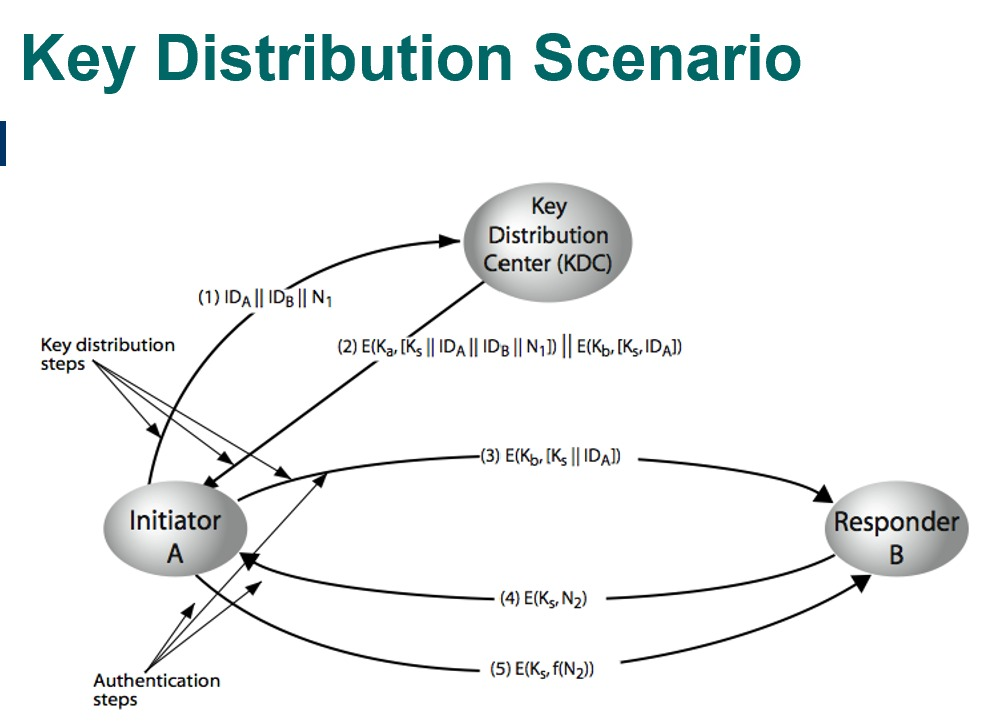

# AES-128 + Key Distribution Center (KDC)

Project ini dibuat untuk memenuhi **Tugas 2 mata kuliah Keamanan Informasi**. Program mengimplementasikan komunikasi terenkripsi antara Alice dan Bob menggunakan algoritma AES-128, dengan bantuan Key Distribution Center (KDC) sebagai pihak yang mendistribusikan kunci.

Implementasi AES dan KDC dibuat secara manual menggunakan Python, tanpa library kriptografi pihak ketiga.

## Anggota Kelompok

| Nama | NRP | GitHub |
|---|---|---|
| Erica Triana W. | 5025241069 | [ericatriana](https://github.com/ericatriana) |
| Nasyita Larasati E. | 5025241201 | [imstunning](https://github.com/imstunning) |

## Konsep dan Cara Kerja Sistem

Sistem terdiri dari tiga entitas utama, yaitu **Alice, Bob, dan KDC**, yang dijalankan pada tiga perangkat dengan IP address berbeda.

- **Alice:** Pihak yang memulai permintaan komunikasi.
- **Bob:** Pihak yang menerima permintaan komunikasi dari Alice.
- **KDC:** Pihak ketiga tepercaya yang membuat dan mendistribusikan session key.

Dalam sistem ini digunakan tiga jenis kunci:

- **Ka:** Kunci rahasia antara Alice dan KDC.
- **Kb:** Kunci rahasia antara Bob dan KDC.
- **Ks:** Session key yang dibuat oleh KDC untuk komunikasi Alice dan Bob.

Awalnya, Alice dan Bob belum memiliki kunci bersama. Alice kemudian meminta session key kepada KDC. KDC membuat Ks dan mendistribusikannya secara terenkripsi agar Alice dan Bob dapat menggunakan kunci yang sama tanpa mengirimkan Ks dalam bentuk plaintext melalui jaringan.

### Protokol Distribusi Kunci

Proses distribusi kunci dan autentikasi mengikuti protokol lima langkah sesuai skenario tugas.

| Langkah | Proses |
|---|---|
| 1 | Alice mengirim identitas Alice, identitas Bob, dan nonce N1 kepada KDC. |
| 2 | KDC membuat Ks, lalu mengirimkan informasi terenkripsi untuk Alice beserta ticket untuk Bob. |
| 3 | Alice meneruskan ticket dari KDC kepada Bob. |
| 4 | Bob mengirim challenge berupa nonce N2 yang dienkripsi menggunakan Ks. |
| 5 | Alice mengirim hasil fungsi f(N2) yang dienkripsi menggunakan Ks sebagai jawaban autentikasi. |

Pada implementasi ini, fungsi **f(N2)** dilakukan dengan membalik urutan karakter nonce N2.

Setelah kelima langkah berhasil, Alice dan Bob dapat saling mengirim dan menerima pesan yang dienkripsi menggunakan AES-128 dengan session key yang sama.

## Implementasi AES-128

AES-128 dibuat secara manual, meliputi proses **SubBytes, ShiftRows, MixColumns, AddRoundKey, dan Key Expansion**.

Setiap pesan dienkripsi menggunakan session key (Ks) sebelum dikirim melalui jaringan. Penerima mendekripsi ciphertext menggunakan Ks untuk mendapatkan kembali pesan aslinya.

Komunikasi dilakukan menggunakan socket TCP, dengan plaintext dan key berformat ASCII serta ciphertext yang ditampilkan dalam format hexadecimal.

## Fitur Sesuai Ketentuan Tugas

- **AES-128 manual:** Implementasi enkripsi dan dekripsi tanpa library AES siap pakai.
- **KDC manual:** Implementasi distribusi session key secara mandiri.
- **Protokol lima langkah:** Distribusi kunci dan autentikasi mengikuti skenario Alice–KDC–Bob.
- **Tiga IP berbeda:** Alice, Bob, dan KDC dijalankan pada perangkat dengan alamat IP berbeda.
- **Komunikasi dua arah:** Alice dan Bob dapat saling mengirim serta menerima pesan terenkripsi.
- **Format ASCII dan Hex:** Key dan plaintext menggunakan ASCII, sedangkan ciphertext ditampilkan dalam Hex.
- **Key dapat diubah:** Ka dan Kb dapat diperbarui secara interaktif tanpa menjalankan ulang program.

## Fitur Tambahan

### 1. AES-CBC dengan IV Acak

Program menggunakan mode **Cipher Block Chaining (CBC)** dengan Initialization Vector (IV) yang dibuat secara acak pada setiap proses enkripsi.

Penggunaan IV acak memungkinkan plaintext dan key yang sama menghasilkan ciphertext berbeda, sehingga pola pesan tidak langsung terlihat dari hasil enkripsinya.

### 2. HMAC-SHA256

Program menggunakan **HMAC-SHA256** untuk memeriksa integritas dan autentikasi pesan terenkripsi.

Setiap ciphertext dilengkapi authentication tag yang diperiksa sebelum dekripsi. Apabila ciphertext dimodifikasi atau key tidak sesuai, autentikasi akan gagal dan paket ditolak.

### 3. Session Key Renewal (`/renew`)

Fitur `/renew` memungkinkan Alice meminta session key baru kepada KDC tanpa menjalankan ulang program.

Ketika fitur digunakan, sesi sebelumnya diakhiri dan protokol lima langkah dilakukan kembali. KDC membuat Ks baru untuk digunakan pada sesi komunikasi berikutnya.

Fitur ini menerapkan konsep **key rotation**, yaitu pembaruan kunci untuk membatasi penggunaan satu session key secara terus-menerus.
